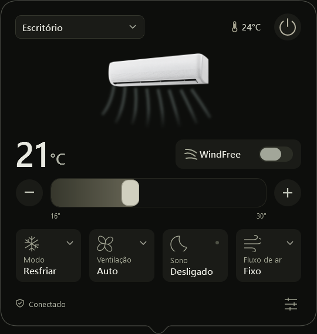
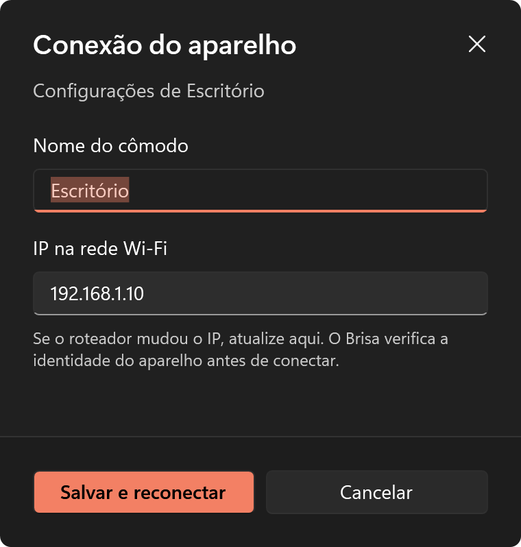

<p align="center"></p>
<h1 align="center">Brisa</h1>
<p align="center">Controle seus ares Samsung pela bandeja do Windows.</p>
<p align="center"><strong>Windows x64</strong> · WPF · Conexão local</p>

<p align="center"></p>

O Brisa abre junto ao ícone da bandeja e reúne temperatura, energia, modo, ventilação, sono, WindFree e direção do ar. O seletor no topo troca o cômodo; cada aparelho mantém sua própria identidade e seus controles disponíveis.

## Usar

Abra `Brisa.exe` e clique no floco de neve perto do relógio. Se o Windows ocultar o ícone, procure na seta **Mostrar ícones ocultos**. Clique fora do painel para recolhê-lo e use o menu do ícone para sair.

Escolha o cômodo, ajuste a temperatura pela barra ou pelos botões **− / +** e use os cartões para os demais controles. O aplicativo confirma as alterações pela resposta do aparelho. O botão de ajustes permite renomear o cômodo e atualizar seu IP.

<details>
<summary>Conexão e configurações</summary>

<p align="center"></p>

Reserve um IP para cada ar no roteador. Se o endereço mudar, atualize o cadastro e reaplique a proteção de rede.

</details>

## Compilar

Requer Windows 10/11 x64, .NET Framework 4.8 e Python 3.14 x64 com pip. Na raiz do projeto:

```powershell
powershell -NoProfile -ExecutionPolicy Bypass -File .\src\setup.ps1
```

O script baixa o runtime portátil do [Python](https://www.python.org/downloads/release/python-3146/), verifica seu SHA-256, instala os pacotes fixados em `requirements.txt` com verificação de hashes e compila o executável. Mantenha `src`, `assets`, `runtime`, `libs` e `data` junto de `Brisa.exe`.

Depois de alterar o código C#, basta executar `src\build.ps1`.

Para verificar o cadastro sem conectar a aparelhos: `runtime\python.exe -m unittest discover -s tests -v`.

## Cadastrar aparelhos

O computador e o ar precisam estar na mesma rede. Com o Brisa fechado, informe o nome do cômodo e o IP mostrado pelo roteador:

```powershell
.\runtime\python.exe .\src\register_device.py --name "Escritório" --ip 192.168.1.10
```

Repita para cada cômodo, usando o IP correspondente. O cadastro lê a identidade do aparelho e salva seu hash em `data\devices.json`. A compatibilidade foi verificada com o Samsung **AR12DYFAAWKNAZ**; outros modelos e firmwares podem não aceitar a autenticação local utilizada.

## Conexão e privacidade

A interface usa C# e WPF; um processo Python mantém a sessão CoAP/DTLS com o ar por meio de [smartthings-local](https://github.com/QuiteYellow/SmartThings-Local). O aplicativo não precisa de token da API SmartThings para enviar os comandos locais.

A chave privada fica protegida pelo Windows DPAPI para o usuário que fez o cadastro. Configurações pessoais, chaves, bibliotecas baixadas e executáveis não entram no Git. As licenças das dependências acompanham os pacotes instalados.

Execute `Aplicar-protecao.ps1` para restringir as conexões de saída dos executáveis do Brisa aos IPs cadastrados, preservando o loopback. O Windows pedirá acesso de administrador. `Desfazer-protecao.ps1` remove essas regras. A proteção vale para a pasta onde foi aplicada e deve ser reaplicada após mudar os IPs ou mover o aplicativo; ela não controla as conexões feitas pelo próprio ar-condicionado.

## Licença

O Brisa usa a licença [MIT](LICENSE). As dependências mantêm suas próprias licenças.
